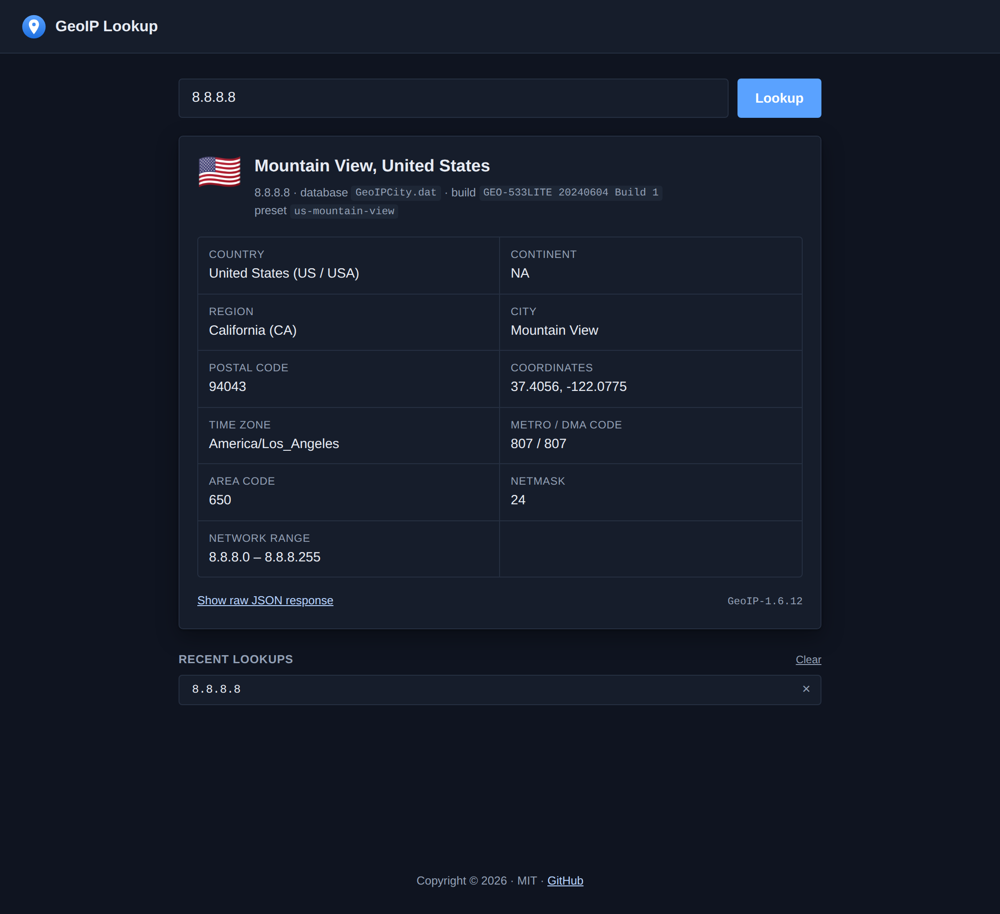

# geoip-wla

A small **TypeScript + React** UI for a GeoIP address-lookup service, with two
backends:

- a **native backend** — a [libnetq](https://github.com/libnetq/libnetq) web
  module (`module.c`) that answers lookups with
  [`geoip-api-c`](https://github.com/maxmind/geoip-api-c) against the legacy
  GeoIP City databases, and a tiny host executable (`server.c`) that loads it;
- a dependency-free **JS emulation server** that returns hardcoded JSON in the
  same shape, so the UI can be developed and demoed without the native build.

All requests and responses are **JSON**.



## Layout

```
src/            TypeScript/React source for the client
  index.html      HTML template (copied to dist as-is)
  index.tsx       entry point
  App.tsx         UI
  api.ts          JSON fetch client
  types.ts        response types (mirror geoip-api-c's GeoIPRecord)
  styles.css      styles (bundled into the hashed CSS file)
  favicon.svg     favicon (copied to dist)
  logo_wla.svg    presentation logo for the main page (copied to dist)

module.c        native libnetq web module "geoip" (POST <base>lookup + client assets)
server.c        native host executable: loads the "geoip" module on localhost:8033
config.h.in     CMake-generated config (base/service URL, assets dir, database names)
CMakeLists.txt  native build: geoip_wla module, geoip_server, client build, databases
bitmake.config.mjs  bitmake recipe: builds the native dependencies + this project

server/         JS emulation server (no npm dependencies)
  server.js       Node http server, returns hardcoded JSON
  presets.js      the hardcoded response presets
  admin.html      admin page to pick the active preset (part of the server)

dist/           client build output — client files only
  index.html
  index-<hash>.js       bundled app (React inlined)
  index-<hash>.css      bundled styles
  favicon.svg
  logo_wla.svg          presentation logo (manifest `screenshots`)
  TwemojiCountryFlags.woff2  flag emoji font for Chromium on Windows
  manifest.json         asset manifest (name, base URL, entries, file map)

build.mjs       esbuild build script (no framework CLI)
docs/           screenshot used in this README
```

`dist/` contains **only client files**. `admin.html` lives in `server/` because
it is part of the server.

## Requirements

- Node.js 18+ (the emulation server uses only built-in modules)
- For the native backend: CMake 3.19+, a C compiler, `make`, `gunzip`, and
  network access (bitmake downloads the dependency sources and CMake downloads
  the GeoIP databases)

## Install

```
npm install
```

Every dependency is in **`devDependencies`** — `react`/`react-dom` are bundled
into the hashed JS file at build time, and nothing is needed at runtime by the
client. The emulation server uses only Node built-ins.

## Build the client

```
npm run build      # -> dist/{index.html, index-<hash>.js, index-<hash>.css, favicon.svg, logo_wla.svg, TwemojiCountryFlags.woff2, manifest.json}
npm run watch      # rebuild on change (unhashed names)

# served under a path prefix — accepted by build, watch and dev
# (CMake passes it to `npm run build`):
npm run build --base-url=/geoip/
npm run dev   --base-url=/geoip/
```

`--base-url` may also be given as a direct script argument
(`node build.mjs --base-url=/geoip/` or `npm run build -- --base-url=/geoip/`).
It sets `manifest.base`, `main` and every URL in `manifest.json`, and the asset
references in `dist/index.html`.

The value is used as given — only a leading slash is added, a trailing slash is
never added or removed. `manifest.base`, `main` and the URL of `index.html` are
exactly that value; every other asset is placed under it with a slash:

| `--base-url` | `base` / `main` / `index.html` | other assets          |
| ------------ | ------------------------------ | --------------------- |
| _(none)_     | `/`                            | `/favicon.svg`, …     |
| `/geoip`     | `/geoip`                       | `/geoip/favicon.svg`, … |
| `/geoip/`    | `/geoip/`                      | `/geoip/favicon.svg`, … |

### Country flags on Windows

Country flags are emoji, and Windows' emoji font has no flag glyphs, so
Chromium-based browsers there (Chrome, Edge, Opera) show the two-letter code
(e.g. `UA`) instead. [`country-flag-emoji-polyfill`](https://github.com/talkjs/country-flag-emoji-polyfill)
detects this at startup and, only in that case, loads `TwemojiCountryFlags.woff2`
(~80 KB, restricted to flag code points) from `dist/` for the `.flag` element.
The build copies the font from `node_modules`; no CDN is used.

The flag artwork is from [Twemoji](https://github.com/twitter/twemoji),
© Twitter, Inc and other contributors, licensed under
[CC-BY 4.0](https://creativecommons.org/licenses/by/4.0/).

## Build the native backend

```
npm run bitmake    # = npx bitmake build
```

[`bitmake.config.mjs`](bitmake.config.mjs) builds, into `build/`:

1. host tools (m4, autoconf, automake, libtool, gettext) into `build/devtool`;
2. static zlib, OpenSSL, civetweb, jansson and GeoIP (`geoip-api-c` 1.6.12),
   plus shared libnetq (JSON backend: jansson, with civetweb, OpenSSL and zlib),
   installed under `build/package`;
3. this project with CMake (Debug), installed under `build/package`.

The CMake build runs `npm install` and `npm run build --base-url=${GEOIP_BASE_URL}`
for the client, downloads `GeoIPCity.dat` and `GeoIPCityv6.dat` from
[mailfud.org/geoip-legacy](https://mailfud.org/geoip-legacy/) (once, cached in
the build tree) and installs:

| Path (under the install prefix) | Contents                                    |
| ------------------------------- | ------------------------------------------- |
| `bin/geoip_server`              | host executable                             |
| `bin/geoip_wla.so`              | the `geoip` web module (`.dylib` on macOS)  |
| `share/geoip-wla/`              | `dist/` client files + the `.dat` databases |

The module finds `manifest.json` and the databases at `../../share/geoip-wla`
relative to its own file, so the installed tree can be relocated as a whole.

CMake options:

| Option                    | Default | Purpose                                         |
| ------------------------- | ------- | ----------------------------------------------- |
| `GEOIP_BASE_URL`          | `/`     | URL prefix the module and client are served under |
| `GEOIP_INSTALL_SERVER`    | `ON`    | install `geoip_server`                          |
| `GEOIP_INSTALL_MODULE`    | `ON`    | install the `geoip_wla` module                  |
| `GEOIP_INSTALL_ASSETS`    | `ON`    | install the `dist/` client files                |
| `GEOIP_INSTALL_DATABASES` | `ON`    | download and install the GeoIP databases        |

The lookup endpoint is `${GEOIP_BASE_URL}lookup`, with a trailing slash added to
the base URL first if missing (`/geoip` → `/geoip/lookup`).

## Run

```
npm run server     # native: build/package/bin/geoip_server on http://localhost:8033
npm run dev        # build the client, then npm run server
npm start          # JS emulation server on http://localhost:8787  (set PORT to change)
```

The emulation server serves the built `dist/` at `/`, so open
<http://localhost:8787/>.

## Changing the emulated JSON

With the emulation server running (`npm start`), open <http://localhost:8787/admin.html>, pick a preset, and click **Apply
preset**. Every subsequent `POST /lookup` returns that preset's JSON until you
change it again. Presets are defined in [`server/presets.js`](server/presets.js);
the selection is held in memory and resets to the default on restart.

## API

### `POST /lookup`

Request:

```json
{ "ip": "8.8.8.8" }
```

Response (emulation server, preset `us-mountain-view`):

```json
{
  "ip": "8.8.8.8",
  "preset": "us-mountain-view",
  "found": true,
  "library": "GeoIP-1.6.12",
  "database": "GeoIPCity.dat",
  "database_build": "GEO-533LITE 20240604 Build 1",
  "record": {
    "country_code": "US",
    "country_code3": "USA",
    "country_name": "United States",
    "region": "CA",
    "region_name": "California",
    "city": "Mountain View",
    "postal_code": "94043",
    "latitude": 37.4056,
    "longitude": -122.0775,
    "dma_code": 807,
    "area_code": 650,
    "metro_code": 807,
    "continent_code": "NA",
    "time_zone": "America/Los_Angeles",
    "netmask": 24,
    "network_start": "8.8.8.0",
    "network_end": "8.8.8.255"
  }
}
```

`record` mirrors `geoip-api-c`'s `GeoIPRecord` struct, plus `time_zone`
(`GeoIP_time_zone_by_country_and_region`) and `network_start`/`network_end`
(`GeoIP_range_by_ip`, IPv4 only). `database_build` mirrors `GeoIP_database_info`
and `library` is `"GeoIP-" + GeoIP_lib_version()`.

When the address is not in the database, `record` is `null` and `found` is
`false` — this mirrors `GeoIP_record_by_addr()` returning `NULL` in
`geoip-api-c`.

IPv6 addresses (anything containing `:`) are looked up in `GeoIPCityv6.dat`;
`network_start`/`network_end` are always `null` for them.

#### Native backend differences

- `preset` is not included, and `database` is the libGeoIP description of the
  open database (`GeoIPDBDescription`) rather than a file name.
- When there is no city record but the country is known, `record` has the
  country fields and `continent_code`; city-level fields are `null`.
- Only `POST` is accepted. Errors return `{ "error": "<message>" }`: `400` for
  an empty body, invalid JSON or a missing `ip`, and `503` when the database for
  that address family was not compiled in.

#### Emulation server extras

`GET /lookup?ip=8.8.8.8` is also accepted for quick testing.

### Admin endpoints (emulation server only)

| Method & path            | Purpose                                  |
| ------------------------ | ---------------------------------------- |
| `GET /api/admin/presets` | list all presets + the active one        |
| `GET /api/admin/state`   | active preset id + its response          |
| `POST /api/admin/state`  | `{ "preset": "<id>" }` — switch presets  |
| `GET /api/health`        | liveness probe                           |

## How the native backend maps to `geoip-api-c`

The `record` fields correspond directly to the `GeoIPRecord` struct in
`geoip-api-c`'s `GeoIPCity.h`. [`module.c`](module.c) opens each database once
at module load (`GEOIP_MEMORY_CACHE | GEOIP_CHECK_CACHE`, UTF-8 charset), takes
a per-database mutex for each lookup, and roughly does:

```c
GeoIP *gi = GeoIP_open("GeoIPCity.dat", GEOIP_MEMORY_CACHE);
GeoIPRecord *r = GeoIP_record_by_addr(gi, ip);
/* serialize r (or null) to the JSON shape above */
GeoIPRecord_delete(r);
GeoIP_delete(gi);
```

falling back to `GeoIP_id_by_addr()` for a country-only match. The emulation
server just returns a frozen version of that JSON, selectable from `admin.html`.
